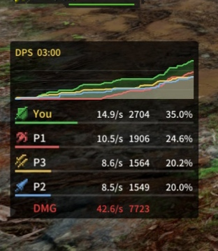

# MHGU DPS Meter

[中文](#zh) | [English](#en)

[](docs/demo.jpg)

<a id="zh"></a>
## 中文

《怪物猎人 GU》（Monster Hunter Generations Ultimate）1.4.0 的 Forge DPS 面板插件，显示四名玩家的整场累计伤害、总伤害、秒伤和百分比。

需要先安装 **Forge 1.5.1** 前置：[https://github.com/Lawrence-al/forge](https://github.com/Lawrence-al/forge)

### 数据说明

- 插件统计本机游戏能够处理到的命中，自己的伤害最准确；
- 主机端通常能看到较完整的队伍伤害；作为客机加入时，其他玩家的伤害更依赖网络同步，可能出现延迟、缺失或数值不准确；
- 请不要把客机端显示的其他玩家数据当作精确结算依据。

### 使用提醒

DPS 统计可能让部分玩家感到压力或不适。联机时请尊重队友，不要用数据指责、嘲讽或强迫他人；和路人游玩时，建议先询问对方是否介意，或暂时关闭面板。

### 兼容的伤害显示

本版只有一个 NRO：`mhgu_dps_meter.nro`，已分别测试兼容：

- [FF14-style Damage Text v011](https://gamebanana.com/mods/727751)
- [Damage Numbers r30](https://gamebanana.com/mods/725408)
- [MHGU Attack Damage Display](https://github.com/Lawrence-al/mhgu-attack-damage-display)
- 单独使用

### 安装

1. 安装 Forge 1.5.1 前置；
2. 把 `romfs` 目录放到 MHGU 的 mod 目录，确保包含：
   - `romfs/nativeNX/plugins/mhgu_dps_meter.nro`
   - `romfs/nativeNX/forge/fonts/NotoSansSC-Medium.otf`
   - `romfs/nativeNX/forge/fonts/OFL.txt`
3. 把 `conf/mhgu_dps_meter.ini` 放到 MHGU 当前用户的存档根目录，或首次运行时让插件自动生成；
4. 完全退出并重启游戏；
5. 在 Forge 菜单中确认 `Enable DPS meter` 已开启。

### 使用

- 面板默认显示在画面左侧、玩家名字下方；
- 默认行标签为 `You / P1 / P2 / P3 / P4`；这些是 slot 标签，不代表队伍顺序或主机顺序；
- 行按伤害从高到低排列；
- 换区会保留 DPS 累计，只会清理旧的浮动伤害数字；结算或保存画面出现约 60 帧（视帧率约 1–2 秒）后自动清零；
- 单人任务也会显示；两名及以上玩家时显示底部全队统计；
- 关闭统计：在 Forge 菜单取消 `Enable DPS meter`，或把 INI 的 `enabled` 改为 `false`；
- 重置本轮数据：使用 Forge 菜单中的 `Reset DPS`。

### 配置

配置文件是存档根目录的 `mhgu_dps_meter.ini`，也可以在 Forge → Plugin UI → `MHGU DPS Meter` 中修改。

手动修改或删除 INI 后，需要完全退出游戏再启动；Forge 菜单中的修改会实时预览。

```ini
[display]
; DPS 统计总开关。关闭后不统计伤害，也不会显示 DPS 面板。
enabled = true

; DPS 面板使用的字体。default = 随插件提供的 NotoSansSC 中文字体；
; 也可以填 TTF/OTF 文件名，并把文件放到 romfs/nativeNX/forge/fonts/。
font_file = default

[dps]
; 黑色背景透明度，0 = 完全透明，255 = 完全不透明。
dps_background_alpha = 180.0

; 是否显示面板顶部的 DPS 计时。
dps_show_timer = true

; 是否显示每名玩家的总伤害。
dps_show_damage = true

; 是否显示每名玩家的伤害百分比。
dps_show_percent = true

; 是否显示每名玩家的每秒伤害（秒伤）。
dps_show_dps = true

; 是否在玩家名字后面显示命中次数，例如 12h。
; 开启后会强制使用上下两行样式。
dps_show_hits = false

; true = 显示游戏内玩家名称；false = 显示 You/P1/P2/P3/P4。
dps_show_names = false

; true = 秒伤、总伤、百分比以同一字号排在右侧同一行；
; false = 保持总伤上排、秒伤下排的两行形式。
dps_inline_stats = true

; true = 在底部显示全队总伤害和全队秒伤（红色）。
dps_show_team = true

; 面板左上角 X 坐标，720p 基准像素；默认 16。
dps_offset_x = 16.0

; 面板左上角 Y 坐标，720p 基准像素；默认 340。
dps_offset_y = 340.0

; true = 显示上方累计伤害曲线图。
dps_show_curve = true

; 曲线面板宽度，720p 基准像素，允许 220～600；默认 270。
dps_curve_width = 270.0

; 上方曲线图高度，720p 基准像素，允许 55～200。
dps_curve_height = 55.0

; 是否在曲线下方画同色半透明填充。
dps_curve_fill = true

; 是否在玩家名字下方显示同色百分比进度条。
dps_show_percent_bar = true

; true = 显示武器图标；false = 完全关闭图标。
dps_show_weapon = true
```

### 开发资料

内存偏移、Hook 流程、猎猫类型调查的失败实验、NRO 重定位检查和原始诊断日志都在 [research/](research/README.md)，供维护者和想用 Forge 做类似插件的人参考。

<a id="en"></a>
## English

A Forge DPS overlay for **Monster Hunter Generations Ultimate (MHGU) 1.4.0**. It shows the whole-party cumulative damage chart, total damage, DPS, and percentage for up to four players.

Requires **Forge 1.5.1**: [https://github.com/Lawrence-al/forge](https://github.com/Lawrence-al/forge)

### Data accuracy

- The meter counts hits the local game can process; your own values are the most accurate.
- The host usually sees more complete party damage. When joining as a guest, other players' damage depends more on network synchronization and may be delayed, incomplete, or inaccurate.
- Do not treat guest-side values for other players as exact results.

### Fair play

DPS meters can make some players uncomfortable. Please respect your teammates and do not use the data to blame, mock, or pressure others. When playing with random players, consider asking first or turning the panel off.

### Damage display compatibility

This release has a single NRO, `mhgu_dps_meter.nro`, tested with:

- [FF14-style Damage Text v011](https://gamebanana.com/mods/727751)
- [Damage Numbers r30](https://gamebanana.com/mods/725408)
- [MHGU Attack Damage Display](https://github.com/Lawrence-al/mhgu-attack-damage-display)
- Standalone use

### Installation

1. Install the Forge 1.5.1 prerequisite.
2. Copy the `romfs` directory into the MHGU mod directory, including:
   - `romfs/nativeNX/plugins/mhgu_dps_meter.nro`
   - `romfs/nativeNX/forge/fonts/NotoSansSC-Medium.otf`
   - `romfs/nativeNX/forge/fonts/OFL.txt`
3. Copy `conf/mhgu_dps_meter.ini` to the MHGU save root, or let the plugin create it on first launch.
4. Fully exit and restart the game.
5. Enable `Enable DPS meter` in the Forge menu.

### Usage

- The panel appears on the left, below the player/party names.
- Default labels are `You / P1 / P2 / P3 / P4`. These are slot labels, not party order or host order.
- Rows are sorted by damage, highest first.
- Area changes keep DPS totals; only old floating damage numbers are cleared. Data clears about 60 frames (roughly 1–2 seconds depending on frame rate) after the save/result screen appears.
- Single-player quests are supported; the team summary appears with two or more players.
- To disable the overlay, turn off `Enable DPS meter` or set `enabled = false` in the INI.
- To reset the current run, use `Reset DPS` in the Forge menu.

### Configuration

The INI file is `mhgu_dps_meter.ini` in the MHGU save root. It can also be edited from Forge → Plugin UI → `MHGU DPS Meter`.

After editing the INI manually, fully restart the game. Menu changes preview immediately.

| Key | Default | Meaning |
|---|---|---|
| `enabled` | `true` | Enable damage tracking and the panel |
| `font_file` | `default` | Bundled Noto Sans SC, or a TTF/OTF filename |
| `dps_background_alpha` | `180.0` | Background opacity, 0–255 |
| `dps_show_timer` | `true` | Show elapsed timer |
| `dps_show_damage` | `true` | Show total damage |
| `dps_show_percent` | `true` | Show percentage |
| `dps_show_dps` | `true` | Show DPS |
| `dps_show_hits` | `false` | Show hit count; forces the two-line layout |
| `dps_show_names` | `false` | Show in-game names instead of slot labels |
| `dps_inline_stats` | `true` | DPS/total/percentage on one line |
| `dps_show_team` | `true` | Show the team summary row |
| `dps_offset_x` | `16.0` | Panel X position, 720p reference |
| `dps_offset_y` | `340.0` | Panel Y position, 720p reference |
| `dps_show_curve` | `true` | Show the cumulative damage chart |
| `dps_curve_width` | `270.0` | Panel width, 720p reference |
| `dps_curve_height` | `55.0` | Chart height, 720p reference |
| `dps_curve_fill` | `true` | Fill below the chart |
| `dps_show_percent_bar` | `true` | Show percentage bars |
| `dps_show_weapon` | `true` | Show weapon icons |

### Development notes

Memory offsets, hook flow, the failed Palico-type investigation, NRO relocation checks, and the raw diagnostic log are in [research/](research/README.md), for maintainers and anyone building similar Forge plugins.
